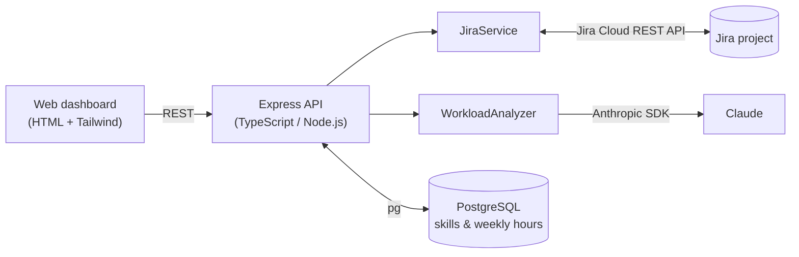

# NeuralLoad AI

**An AI assistant that balances workload across engineering teams.**

NeuralLoad AI connects to a team's Jira project, measures how loaded each engineer is relative to their capacity, and uses Claude (Anthropic) to recommend which tasks should move to whom, taking into account each person's skills, current workload, and task priority and deadlines. A manager reviews each suggestion and, with one click, the reassignment is written straight back to Jira.

Built at the **AIEngine Hackathon (February 2025)** by team *Al-Khwarizmi's Apprentices*.

---

## Features

- **Live Jira integration:** pulls project members and open issues (estimates, due dates, priority, labels) through the Jira Cloud REST API.
- **Capacity-aware workload model:** converts every open task into a daily load based on its estimate and the working days left before its due date, then compares the total with each engineer's own weekly hours.
- **Skills profiles:** each team member has a set of skills, stored in PostgreSQL and matched against Jira labels on each task.
- **AI reassignment suggestions:** Claude receives the team's skills, workloads and the movable ("To Do") tasks, and proposes specific moves under strict rules: the new assignee must hold *every* skill the task requires, and each move must improve the balance of work.
- **Human in the loop:** suggestions appear in the dashboard with **Accept** / **Reject** buttons; accepted moves update the assignee in Jira immediately.
- **Team management:** add members, set weekly hours and edit skills from the UI.

## How the workload model works

For each open task assigned to an engineer:

1. **Available time:** count the working days (Mon–Fri) from today until the due date (default: 10 working days if none is set). Daily capacity is `weekly hours / 5`.
2. **Task intensity:** `estimated hours / (working days × daily capacity)`, i.e. the fraction of that person's time the task needs until its deadline.
3. **Daily load:** intensity × daily capacity gives the hours per day the task demands.

Summing over all tasks gives each engineer's **workload percentage** (daily load ÷ daily capacity). These percentages, together with skills and weekly hours, are passed to Claude along with every "To Do" task. Each suggested move comes back with its effect on both engineers' workload (before → after), so the manager can see why it was proposed.

The analyser also computes a combined workload score from task complexity, estimated hours and skill-match quality, which is used by the `/api/workload-analysis` endpoint.

## Architecture



## Tech stack

| Layer | Technology |
|---|---|
| Backend | TypeScript, Node.js, Express |
| Database | PostgreSQL (`pg`) |
| Integrations | Jira Cloud REST API (`axios`), Anthropic API (`@anthropic-ai/sdk`) |
| Frontend | HTML, Tailwind CSS, vanilla JavaScript |

## Project structure

```
src/
├── index.ts                   # Express server and /api/workload-analysis endpoint
├── config/database.ts         # PostgreSQL connection pool
├── routes/memberRoutes.ts     # Members, skills, AI suggestions, task reassignment
├── services/
│   ├── jiraService.ts         # Jira API client and workload calculations
│   └── workloadAnalyzer.ts    # Workload scoring and Claude prompts
├── database/
│   ├── schema.sql             # Full database schema
│   └── migrations/            # Incremental migrations (skills table, weekly hours)
├── types/index.ts             # Shared TypeScript types
├── public/index.html          # Dashboard UI
└── testJiraConnection.ts      # Quick check that Jira credentials work
init.sql                       # Earlier schema with sample data (for local experiments)
```

## Getting started

### Prerequisites

- Node.js 18+
- PostgreSQL 14+
- A Jira Cloud project and an [API token](https://id.atlassian.com/manage-profile/security/api-tokens)
- An [Anthropic API key](https://console.anthropic.com/)

### Setup

```bash
# 1. Install dependencies
npm install

# 2. Configure environment variables
cp .env.example .env
#    then fill in your database, Jira and Anthropic credentials

# 3. Create the database and schema
createdb workload_management
psql -d workload_management -f src/database/schema.sql

# 4. (Optional) Check your Jira credentials
npm run test:jira

# 5. Start the server
npm start
```

Then open **http://localhost:3000**.

### Environment variables

| Variable | Description |
|---|---|
| `DB_USER`, `DB_PASSWORD`, `DB_HOST`, `DB_PORT`, `DB_NAME` | PostgreSQL connection |
| `JIRA_API_URL` | e.g. `https://your-domain.atlassian.net/rest/api/3` |
| `JIRA_USERNAME` | Email address of the Jira account |
| `JIRA_API_TOKEN` | Jira API token |
| `JIRA_PROJECT_KEY` | Key of the Jira project to analyse |
| `ANTHROPIC_API_KEY` | Anthropic API key |
| `PORT` | Server port (default `3000`) |

## API reference

| Method | Endpoint | Description |
|---|---|---|
| `GET` | `/api/members` | Project members with skills, weekly hours and workload intensity |
| `POST` | `/api/members` | Add a member (name, email, Jira account ID, weekly hours, skills) |
| `POST` | `/api/members/:memberId/skills` | Update a member's skills |
| `GET` | `/api/skills` | Skills available in the project (from Jira labels) |
| `GET` | `/api/jira-users` | Users in the Jira site |
| `GET` | `/api/workload-suggestions` | AI-generated task reassignment suggestions |
| `PUT` | `/api/tasks/:taskId/assignee` | Reassign a Jira issue (`{ "newAssignee": "<accountId>" }`) |
| `GET` | `/api/workload-analysis` | Workload scores per employee plus redistribution suggestions |

## Limitations and next steps

This was built in a hackathon, so a few things are still rough:

- Skill matching is exact on label names; fuzzy or embedding-based matching would handle synonyms (e.g. `js` vs `javascript`).
- The default 10-day window for tasks without a due date is a fixed constant and could be made configurable per team.
- There are no automated tests yet.
- Possible extensions: historical tracking of workload over time, Slack notifications for overloaded engineers, and learning task estimates from past Jira data.
